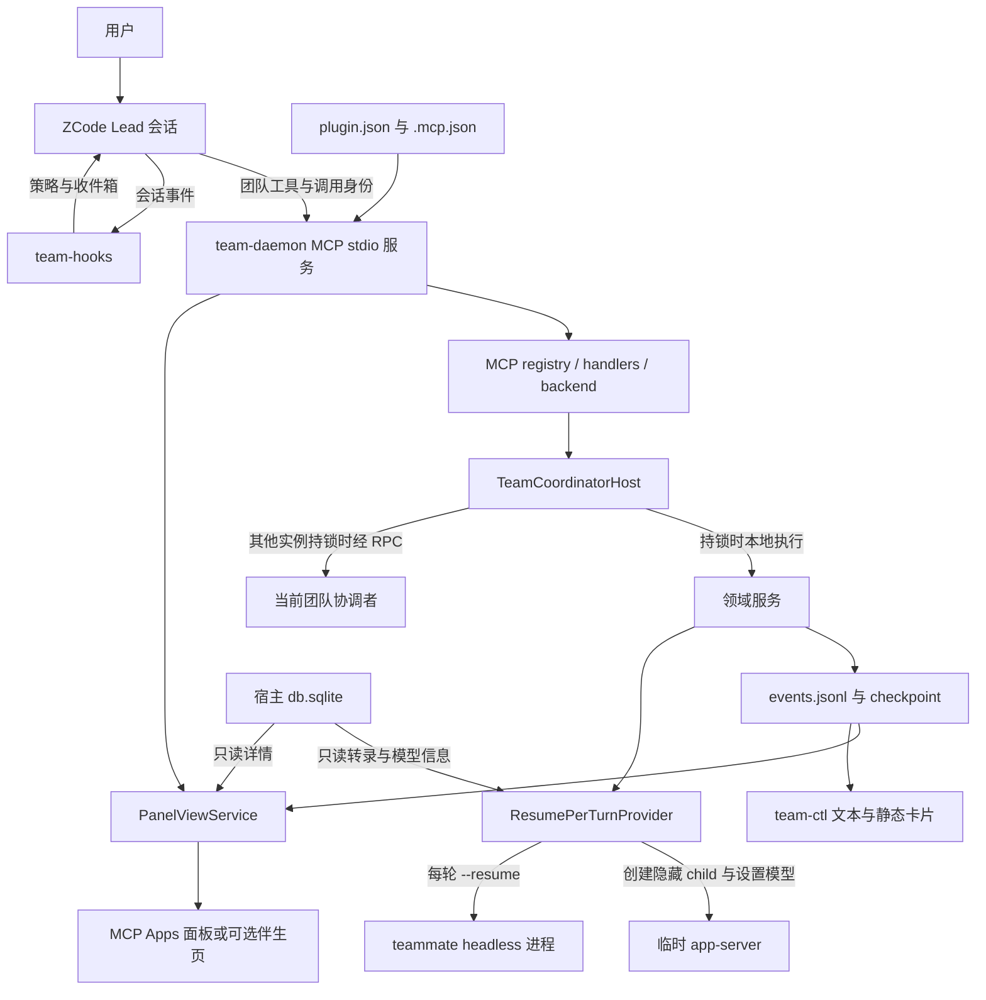

# Agent Team 仓库 Wiki

本项目是给 **ZCode** 使用的团队协作插件：当前会话充当 Lead，插件创建可持续复用的 teammate 子会话，提供共享任务板、成员消息和团队状态面板。成员共享项目工作目录；团队数据写入插件数据目录。

本文用于理解现有实现、定位源码和选择验证入口。基线为 **2026-10-25、版本 0.3.2、源码提交 `7e24db8`**；源码之后的变更应同步更新对应条目。本文属于源码仓库工程文档，不进入插件发布包。

## 1. 阅读入口

| 想了解什么 | 入口 |
|---|---|
| 安装、使用方式、宿主限制 | [README](../README.md)、[使用手册](使用手册.md) |
| 当前模块关系、流程与维护入口 | 本 Wiki |
| 原有架构说明与阶段决策编号 | [架构说明](架构说明-as-built.md) |
| 数据、日志、清理与恢复 | [运维手册](运维手册.md) |
| 测试脚本、夹具与验收分层 | [测试手册](测试手册.md)、[Vitest 配置](../vitest.config.ts) |
| 规格与实现、测试的对应关系 | [追溯矩阵](traceability.md) |
| UI 主题变量 | [设计令牌映射](token-map.md) |
| 版本演进 | [CHANGELOG](../CHANGELOG.md) |

原有文档包含不同阶段的基线，具体差异见第 13 节。追溯矩阵引用的 `zcode-agent-team-plan/` 规格、阶段报告和部分验收证据位于本仓库之外，仓库中的引用不代表这些文件已随源码或插件包提供。

## 2. 产品概念与边界

| 概念 | 当前含义 |
|---|---|
| Lead | 根会话的隐式团队负责人；`teamId` 等于 Lead 的宿主会话 ID |
| teammate | 有名字、可收消息并恢复后续轮次的成员；默认使用宿主原生隐藏子会话 |
| 成员 ID、会话 ID、target | 域层成员 ID 与宿主子会话 ID 通过映射关联；工具调用使用 `spawn_teammate` / `list_agents` 返回的 target |
| 团队任务 | 共享任务板上的记录，带 revision、owner、依赖和预期写作用域 |
| 轮次 | 一次 headless ZCode 进程执行；成员可先后经历多个轮次 |
| 协调者 | 某个团队事件日志当前持有文件锁的唯一写者；进程退出后可由其他实例接任。hooks 仍可独立写回执、预算和 Lead 状态等辅助文件 |

默认 `leadMode=orchestrator`：策略要求 Lead 自主拆活、分派、复核和汇总。`collaborator` 模式省去主动编排段，按用户指示组队。两者使用相同工具和执行权限。

需要区分三组语义：

- **成员空闲与任务完成**：`inactive` 只表示没有轮次执行；任务是否完成由任务板记录。
- **任务提交与验收**：`complete` 是 owner 提交；独立复核、失败后 `reopen`、通过后向 description 追加验收记录，是注入给 Lead 的协作策略。数据模型没有独立的“已验收”状态。
- **写域提示与文件隔离**：成员共享文件系统，`write_scopes` 重叠只产生告警；插件没有为每个成员创建 Git worktree，也没有用这些字段锁住文件。

来源：[协作策略](../src/mcp/policy.ts)、[花名册](../src/domain/roster.ts)、[任务视图](../src/domain/task-view.ts)、[任务板](../src/domain/taskboard.ts)。

## 3. 插件装配与整体架构



### 3.1 装配文件

| 文件 | 职责 |
|---|---|
| [.zcode-plugin/plugin.json](../.zcode-plugin/plugin.json) | 插件标识、版本、6 项 userConfig、skills、commands、hooks 和会话面板 surface |
| [.mcp.json](../.mcp.json) | 启动 `dist/team-daemon.mjs`，设置项目目录和插件数据目录，将 userConfig 映射为环境变量 |
| [hooks/hooks.json](../hooks/hooks.json) | 注册 SessionStart（startup/resume）、Stop、UserPromptSubmit 三类事件 |
| [skills/team-coordination/SKILL.md](../skills/team-coordination/SKILL.md) | 可手动重新加载的团队协作策略；主注入通道是 SessionStart hook |
| [commands/team.md](../commands/team.md) | `/team` 状态摘要与面板、CLI 入口；命令职责是只读展示 |
| [marketplace.json](../marketplace.json) | 开发市场目录及插件展示信息 |

### 3.2 源码分层

| 目录或入口 | 主要文件 | 负责什么 |
|---|---|---|
| [src/domain](../src/domain/) | `events`、`projection`、`invariant`、`runtime`、`ports` | 事件与状态定义、投影、不变量、服务装配和 IO 接口；域层自身不做文件 IO |
| [src/domain](../src/domain/) | `roster`、`mailbox`、`taskboard`、`activity`、`lifecycle` | 成员供给、消息、任务、变更等待与处置 |
| [src/coord](../src/coord/) | `host`、`journal`、`replay`、`store-adapter` | 单写者装配、串行事务、持久追加、checkpoint 与恢复 |
| [src/coord](../src/coord/) | `lock`、`lockfile`、`rpc`、`client`、`methods`、`paths` | 锁与接任、认证 RPC、重试、方法表和安全路径 |
| [src/mcp](../src/mcp/) | `tools`、`registry`、`handlers`、`backend`、`identity`、`policy` | 工具定义、参数和身份处理、领域调用、策略文本 |
| [src/provider](../src/provider/) | `resume-provider`、`session-breeder`、`procgroup`、`member-files` | 隐藏会话供给、每轮启动、中断、落盘与孤儿轮次接管 |
| [src/provider](../src/provider/) | `transcript`、`fork-context`、`model-catalog`、`model-selection` | 宿主转录读取、fork 上下文、模型目录和选择解析 |
| [src/hooks.ts](../src/hooks.ts)、[src/hooks/inbox.ts](../src/hooks/inbox.ts) | hook 入口与收件箱纯逻辑 | 角色与策略注入、Stop block 预算、消息回执 |
| [src/panel](../src/panel/) | `view-service`、`panel-call`、`detail`、两个页面入口、`companion-server` | 数据帧、面板回环、会话摘要及可选本地 HTTP 服务 |
| [src/ui-core](../src/ui-core/) | `tokens`、`dict`、`render`、`detail-render`、`member-settings`、`widget` | 桌面面板、伴生页与卡片共用的主题、词典和渲染 |
| [src/cli](../src/cli/)、[src/sidebar](../src/sidebar/) | `main`、`ui`、`state`、`sidebar-audit`、`tasks-index` | 运维 CLI 和宿主任务索引的受限归档操作 |
| [src/daemon.ts](../src/daemon.ts)、[src/shared.ts](../src/shared.ts) | 进程入口与公共 IO 辅助 | MCP 资源、日志、配置、Node 自检与装配 |

## 4. 启动、身份和调用路径

1. ZCode 启动 MCP stdio daemon；daemon 校验 Node 与配置，准备数据目录并注册工具、资源和可选伴生服务。stdout 留给 MCP 协议，诊断写 stderr 或日志。
2. 每次工具调用优先读取 `_meta.session_id`。已登记为 teammate 的会话映射到原团队；其余合法根会话成为隐式 Lead。无成员映射的一次性 `runtime_scope=subagent` 会话会被拒绝。
3. `_meta.session_id` 不是非空字符串时，按 `firstSeen` 与 daemon 启动时间相差不超过默认 300 秒筛选 session-map，恰有一个候选才兜底；这里未要求候选的 `hookRegistered=true`。无法唯一确定则返回 `TEAM_NOT_MEMBER`。
4. backend **在某团队首次调用时**惰性打开 `TeamCoordinatorHost`，同团队并发首调共享 opening promise。
5. host 抢到团队锁后打开 journal、重放、恢复对账并服务；其他实例走代理模式，经认证 Unix socket 调用当前协调者。

daemon 启动并不立即恢复所有团队。恢复发生在团队 host 被打开和接任时。backend 另有默认 10 分钟的空闲 host 回收，存在在途调用时不回收。

来源：[daemon](../src/daemon.ts)、[身份解析](../src/mcp/identity.ts)、[backend](../src/mcp/backend.ts)、[host](../src/coord/host.ts)。

### 4.1 模型可见工具

默认 **9 个**；`interrupt=false` 时 **8 个**（0.4.0：`member_set_model` 注销）。唯一注册定义在 [tools.ts](../src/mcp/tools.ts)，过滤与调用接线在 [registry.ts](../src/mcp/registry.ts)。

| 工具 | 权限与行为 |
|---|---|
| `spawn_teammate` | Lead 创建命名成员；`context=fresh\|fork`；模型自动跟随 Lead，无独立参数（0.4.0） |
| `send_message` | 团队成员给其他成员发消息；成功返回不等于对方已处理 |
| `list_agents` | 团队成员读取 Lead、成员和当前可用状态 |
| `interrupt_agent` | Lead 中断一个成员当前轮次；保留待收消息；可通过配置移除注册 |
| `wait_agent` | 团队成员等待调用开始后的成员、消息或任务变化；不会唤醒空闲成员 |
| `team_task_create` | 成员创建未分配任务，支持依赖和预期写域 |
| `team_task_list` | 成员分页、过滤读取任务 |
| `team_task_get` | 成员读取单任务最新 revision；可读已删除墓碑 |
| `team_task_update` | 成员按 revision 执行动作；具体 owner / Lead 权限由任务板逐项检查 |

`wait_agent` 默认 30 秒，合法范围为 10 秒至 1 小时；带宿主 progress token 时约每 9 秒通知保活。没有可产出变化的其他运行或创建中成员时，可立即返回 `noProgress`，调用方需重新列状态并在必要时先发消息。

### 4.2 面板通道和资源

| 名称 | 用途 |
|---|---|
| `team_panel_call` | app 专用回环工具，模型不可见；心跳、refresh、detail（0.4.0：零变更通道，modelOptions/setMemberModel 已注销） |
| `team_ping` | 仅 `TEAM_DEBUG_TOOLS=1` 时列出的诊断工具，不计入上述 9 个 |
| `ui://agent-team/team-panel.html` | 自包含面板 HTML，与 manifest 中 `agent-team-panel` surface 对应 |
| `team://view` | 可订阅的团队视图帧 |

（0.4.0：MCP 资源 `team://models` 已下线——成员模型唯一路线 = 每轮跟随 Lead，模型目录仅 provider 层内部分类使用。）

## 5. 关键业务流程

### 5.1 创建与恢复成员

`spawn_teammate → registry/handlers → backend → host 方法表 → TeamRoster.spawnTeammate → ResumePerTurnProvider.startContinuable`。

域层先校验名称和名额，追加 `provisioning` 成员事件；provider 再解析模型、经 app-server 培育隐藏 `selection_side_chat` 子会话，写入 origin 和轮次记录，然后启动 headless 首轮。首条任务被持久接收后，成员供给定案为 `active`；创建失败则记录 `failed` 并处理清理。**成员 active 不要求首轮任务已经做完**。

每轮使用 `zcode -p --resume <childSession> --json --mode yolo --surface terminal --disallowed-tools Task`，由独立进程组承载；helper 确认孵化、写入 PID 后立即退出，provider watcher 再根据进程活性和转录探针定案轮次。app-server 用于会话供给和模型设置，实际工作轮次由 headless CLI 执行。

- `fresh`：首轮任务正文按原文传递，身份和策略由 hook 另行注入。
- `fork`：读取 Lead 已落库的真实用户、assistant 文本与工具名，截断后放在首轮任务之前；导出未额外检查回合完成标记。实现是**文本转录注入**，没有复制完整宿主运行时上下文；默认字符预算 24000，保留最早项与最近项。
- 默认 `child` 隔离模式培育失败会报错，不静默退回顶层会话；`legacy` 是显式回滚形态。

来源：[roster](../src/domain/roster.ts)、[resume-provider](../src/provider/resume-provider.ts)、[session-breeder](../src/provider/session-breeder.ts)、[fork-context](../src/provider/fork-context.ts)。

### 5.2 消息和回合边界

`send_message → TeamMailbox → queued 事件落盘 → provider 投递 → transcript 或 hook 回执确认 → delivered 事件`。

运行中的目标先排队，在可用回合边界处理；空闲 teammate 会恢复新一轮。给 Lead 的消息通过 SessionStart、Stop 或 UserPromptSubmit hook 注入收件箱。Stop 最多 block 3 次/run，防止无限续跑；回执先落盘，RPC ack 用于加速，失败后由恢复或扫描折叠。

模型可见消息有 `Team message from <name>:` 框架头；内部 messageId 用于落盘和去重，不进入框架头。投递确认表示消息已进入目标上下文，业务处理结果仍需成员汇报与验收。

Lead 空闲时的主动唤醒有宿主能力限制。默认依靠 hooks 和下一次用户输入兜底；`TEAM_WAKE_LEAD=1` 才启用实验性的 headless 唤醒，且还受空闲阈值、冷却与单飞锁约束，桌面可能不立即刷新。

`interrupt_agent` 只中断当前轮次，不持久暂停成员，也不释放任务 owner；已有 pending 消息可在轮次边界或默认 2 秒补投扫描时再次启动成员。

来源：[mailbox](../src/domain/mailbox.ts)、[hooks](../src/hooks.ts)、[inbox](../src/hooks/inbox.ts)、[lead-wake](../src/provider/lead-wake.ts)。

### 5.3 共享任务板

更新前读取任务，传入 `expected_revision`；不匹配返回 `TEAM_TASK_STALE_REVISION`。所有候选更新还会校验依赖全图，拒绝自依赖、重复依赖、缺失或已删除 blocker、依赖环。

| 动作 | 主要状态变化或约束 |
|---|---|
| `claim` | ready 的 pending 任务由调用者认领为 in_progress |
| `release` | owner 或 Lead 将 in_progress 退回 pending，清 owner |
| `edit` | owner 或 Lead 修改标题、描述、write scopes，递增 revision |
| `set_dependencies` | owner 或 Lead 修改依赖，并校验全图 |
| `complete` | owner 或 Lead 将 in_progress 标为 completed，保留 owner |
| `reopen` | owner 或 Lead 将 completed 退回 pending，清 owner；可写入问题描述 |
| `reassign` | Lead 指派 owner 或清空 owner；受下述 ready 校验边界约束 |
| `delete` | owner 或 Lead 写 deleted 墓碑；仍被其他非 deleted 任务依赖时拒绝 |

`ready` 仅在 **pending 且所有 blocker 均 completed** 时为 true。当前实现虽然允许 `reassign` 进入 pending/in_progress 分支，但非空 owner 还要求 ready，因此对 in_progress 任务直接换成非空 owner 会返回 `TEAM_TASK_BLOCKED`；清空 owner 可先退回 pending。这是源码可推得的现有边界，现有测试未直接断言“in_progress → 非空 owner”这一分支。

deleted 不占任务限额、不出现在普通 list 中，get 仍可读取；任务完成、依赖解除、owner 指派均不会自动唤醒成员。写域告警仅比较两个 in_progress 任务的路径前缀重叠，提示对称出现，不阻断操作。

来源：[taskboard](../src/domain/taskboard.ts)、[task-graph](../src/domain/task-graph.ts)、[task-view](../src/domain/task-view.ts)。

### 5.4 模型继承（0.4.0：唯一路线 = 每轮跟随 Lead）

模型选择使用 `{providerId, modelId, reasoningLevel?}`。成员**没有任何独立配置通道**（spawn 参数、对话工具、面板弹窗已注销）；provider 在成员每次开始执行前自动同步 Lead 的最新已确认选择。

目录优先读取 `~/.zcode/v2/provider_config.json` 的运行时 Provider Registry；不可用时回退 `~/.zcode/v2/config.json`，两者都不可用则返回空目录并记录诊断。输出通过字段白名单构造（apiKey/baseURL 永不出 daemon）。

Lead 模型解析为**三源按时间戳取最新**：① 真实用户提交消息时宿主写入的 `modelSelection` 快照（输入框切换在提交瞬间生效，不受宿主 issue #7「选模条目不刷新」影响）；② `session_entry(runtime/model_selection)`（`/model` 命令刷新，`time_updated` 参与比较）；③ `model_usage` 中 `query_source='main_turn'` 的最近实际调用（严格排除 compact/标题/subagent/workflow 等辅助行）。解析后按目录分类：官方 `account:*` / `builtin:*` 套餐或目录外组合 = 不可继承；空目录 = 无法分类（守卫：不过滤，宿主 setModel 终审）。

**失败绝不静默**：解析不出 / 官方套餐 / 目录外 / setModel 被拒 → 创建时抛错（不落成员）、续跑时阻止该轮启动，并以可读原因报告用户；不再有「回退宿主缺省冒充继承成功」的降级路径。同步有变化才发 `session/setModel`（生效锚点 = 会话库条目，headless `--resume` 每轮恢复）；运行中成员本轮不打断，下一轮开始时同步；急需切换用 `interrupt_agent` 结束当前轮再续跑。`origin.json` 只记实际生效的选择（`modelSource` 恒 `inherited`）。

**0.4.1 修复轮**（跟随机制可靠性，无契约/工具面变更）：
- **一致性判断以宿主实际状态为准**：轮前比对源 = 成员会话 `session_entry` → `main_turn usage` 实查，`origin.modelSelection` 只是辅助记录（不凭 origin 相同放行）；实际状态无法确认时重新应用 Lead 选择；确认一致时顺带修复落后的 origin；仅档位变化同样识别同步；首轮 createChild 已定模则 launchTurn 跳过（零冗余 setModel）。
- **创建前预检**：provider `preflightMemberModel()` 在 roster 写入 provisioning 事件**之前**执行——不可继承时不增加成员、不占名、不建隐藏子会话，修正 Lead 模型后原名可重用；供给阶段仍复检（漂移防御）。
- **失败可见 + 重试有节制**：解析失败与应用失败统一落 `model-failed.json`（`kind`/`attempts`/`nextAttemptAt`/`leadSignature`/`messageIds`）。确定性拒绝（套餐/目录外/明确不支持）暂停相同选择的自动重试；临时故障（timeout/spawn/ENOENT/app-server 未就绪）按 5s/15s/30s 退避、最多自动重试 3 次；**Lead 换模或用户再发新消息即解锁**。拦截 = `ModelSyncSuppressedError` → deliver 按 `queued` 滞留（消息保留、不误标 delivered、不重复 setModel）。失败记录变化经 `bind(onModelFailureChanged)` → `roster.notifyStatusChanged` 立即刷新成员展示；成功同步或宿主实际状态确认一致即清除旧失败记录与诊断。

宿主输入框切模型不刷新会话选模条目仍是 issue #7 限制，但 0.4.0 的三源判定以提交快照弥补：你切换后提交一条新消息，成员下一轮即跟上。

来源：[model-catalog](../src/provider/model-catalog.ts)、[model-selection](../src/provider/model-selection.ts)、[model-inheritance](../src/provider/model-inheritance.ts)、[resume-provider](../src/provider/resume-provider.ts)、[session-breeder](../src/provider/session-breeder.ts)、[transcript](../src/provider/transcript.ts)。

## 6. 状态、持久化与恢复

### 6.1 四种状态不要混用

| 状态层 | 取值与含义 |
|---|---|
| 成员持久供给阶段 | `provisioning / active / failed`；failed 指创建失败 |
| 工具展示的成员状态 | `provisioning / failed / running / inactive`；active 成员再按当前轮次活性派生 running/inactive |
| 轮次记录 | `starting / running / exited / interrupted / failed / spawn-error` |
| 任务状态 | `pending / in_progress / completed / deleted` |

来源：[事件 schema](../src/domain/events.ts)、[roster](../src/domain/roster.ts)、[成员文件](../src/provider/member-files.ts)。

### 6.2 数据布局

数据根解析顺序为 `TEAM_PLUGIN_DATA → ZCODE_PLUGIN_DATA → CLAUDE_PLUGIN_DATA → ~/.zcode/agent-team-dev-data`。团队目录名由 `safeTeamId` 转义，不应直接拼入未经处理的用户输入。

```text
<dataRoot>/
  logs/                         daemon、provider、hooks、signals 等日志
  meta/runtime-config.json      daemon 落盘的有效配置，供 hooks 回退读取
  session-map.json               宿主会话到团队与成员的映射
  session-map/                   启动时创建的预留目录；实际映射在上述 JSON 文件
  teams/<safeTeamId>/
    events.jsonl                团队事件的权威追加日志
    checkpoint.json             可重建的重放加速快照
    coordinator.lock            持锁者身份
    coordinator.lock.hb-*        按 token 分离的心跳
    coordinator.audit.jsonl      锁与接任审计
    coordinator.sock            常规 RPC socket
    socket.path                 socket 实际路径登记
    rpc.token                   RPC 认证 token
    ui/view-snapshot.json       最近展示帧，供冷启动或断线回放
    lead/state.json             Lead 活跃时间与唤醒冷却状态，hooks 更新
    lead/wake.lock              实验唤醒的单飞锁（按需）
    lead/run/wake-<time>.out     实验唤醒轮次输出（按需）
    members/<memberId>/
      origin.json               身份、会话、首轮指纹及实际生效模型
      receipts.jsonl            消息交付回执
      stop-budget.json          hook 续跑预算
      model-failed.json         模型继承失败诊断（0.4.0：model-pending.json 随队列机制注销）
      run/current.json          当前轮次指针
      run/turn-<n>.json          轮次状态与投递凭据
      run/turn-<n>.out           轮次进程输出
      run/drain-requested.json   处置标记（按需）
```

Lead 的收件回执和 Stop 预算也使用 `members/<teamId>/` 下的对应文件。`lead/state.json` 是实验主动唤醒的辅助状态，不能取代团队事件投影；文件缺失时该唤醒路径不会执行。`logs/`、`meta/` 在数据根下。

### 6.3 一致性与接任

- 领域事件固定为 `team/member`、`team/task`、`team/message/queued`、`team/message/delivered`，事件版本 2；checkpoint 投影状态版本 4，两者版本含义不同。
- journal 记录 `{seq, ts, writer, event}`，串行事务内先用投影验证候选，再追加和 fsync；默认每 256 次提交及关闭时保存 checkpoint。
- checkpoint 无效时回退全量重放；有效时从字节偏移增量恢复。checkpoint 是加速器，正确性依赖事件日志。
- 坏 JSON、序号断裂或已识别团队事件的非法内容会进入 `failure` 终态，显式失败；未知事件类型和非本团队事件按 selector 规则忽略，不能概括为“任何不认识的事件都报错”。
- 单写者由 O_EXCL owner 文件与 token 心跳维持；默认心跳 1000ms、过期 4500ms。接任后恢复成员供给、接管或结算孤儿轮次，并扫描 pending 消息。消息交付集合必须始终是已排队消息集合的子集。
- socket 路径过长时落到 `os.tmpdir()/agent-team-sockets/at-<hash>.sock` 私有目录，由 `socket.path` 发现；不是固定写到共享 `/tmp` 根。
- daemon 被宿主回收时，默认 drain 策略为 `keep`，保留 teammate 轮次；后续协调者依据盘上凭据恢复。daemon 信号处理只给轻量关闭约 200ms，完整恢复不能依赖这次退出成功完成。

来源：[journal](../src/coord/journal.ts)、[replay](../src/coord/replay.ts)、[events](../src/domain/events.ts)、[lock](../src/coord/lock.ts)、[host](../src/coord/host.ts)、[paths](../src/coord/paths.ts)。

## 7. 面板、详情与 CLI

桌面面板经 MCP Apps 订阅 `team://view`。daemon 在订阅期间约每 500ms 构帧，contentKey 变化才通知；single-flight 避免并发构帧，会话 epoch 防止旧会话结果覆盖新会话。面板约每 25 秒通过回环工具心跳保活。

`resources/read` 本身没有调用身份，因此普通资源读取以最近活跃工具调用的 session 为锚；面板 `refresh` 则携带调用身份重新取全量视图。mailbox-only 变化不进入面板 contentKey，消息正文不会随整帧下发。

成员详情由宿主只读转录和团队事件合成，固定为 **用户指令 + 本轮动作组 + 最后一条非空 assistant 结论**；摘要投影在分页前完成。`sourceTotal` 表示投影前原始条数，工具结果合入 toolCall 载荷。当前没有 summary/full 切换，也没有独立 toolResult 条目。详情正文按纯文本展示，Markdown / 代码块排版尚未实现。

| 形态 | 数据与用途 |
|---|---|
| 桌面 MCP Apps 面板 | 自动订阅状态；可看摘要详情（只读通道：0.4.0 起无成员模型设置入口）；任务板无直接编辑控件 |
| 可选伴生页 | `TEAM_COMPANION=1` 开启；127.0.0.1 随机端口、token 认证，SSE 同源推帧 |
| `team-ctl state` | 读盘重放，输出文本或 JSON |
| `team-ctl transcript` | 与面板 detail 共用摘要合成函数；名称中的 transcript 不代表原始全量转录 |
| `team-ctl widget` | 静态卡片或 standalone HTML；不探测实时活性 |
| `team-ctl tail` | 跟随原始事件日志 |
| `team-ctl call` | 通过 RPC 调当前协调者，可包含写操作 |
| `team-ctl sidebar-audit` | 默认 dry-run，`--apply` 才执行归档修复 |
| `team-ctl inject-event` | test-only 原始事件注入，绕过 journal，用于故障演练 |

来源：[view-service](../src/panel/view-service.ts)、[panel-call](../src/panel/panel-call.ts)、[detail](../src/panel/detail.ts)、[companion-server](../src/panel/companion-server.ts)、[CLI](../src/cli/main.ts)。

## 8. 配置与宿主依赖

| userConfig | 默认 | daemon 环境变量 |
|---|---|---|
| `maxMembers` | 8（不含 Lead，包含 failed 成员） | `TEAM_MAX_MEMBERS` |
| `maxTasks` | 256（不含 deleted 墓碑） | `TEAM_MAX_TASKS` |
| `maxMessageBytes` | 65536 | `TEAM_MAX_MESSAGE_BYTES` |
| `disposalTimeoutMs` | 5000 | `TEAM_DISPOSAL_TIMEOUT_MS` |
| `interrupt` | true | `TEAM_INTERRUPT` |
| `leadMode` | orchestrator | `TEAM_LEAD_MODE` |

四个数值限额必须是正安全整数；非法配置会阻止正常工具调用并显式报错。非法 leadMode 则记录告警后回到 orchestrator。hooks 的 leadMode 有环境变量、宿主配置直读、runtime-config 和默认值的回退链，避免首次 hook 早于 daemon 启动时丢失选择。

代码与构建目标要求 Node ≥ 22；sqlite 使用 Node 自带 `node:sqlite`，没有额外原生绑定。宿主会话库 `db.sqlite` 仅读取，创建会话与改模型通过宿主接口；宿主 `~/.zcode/v2/tasks-index.sqlite` 写入局限于 anchor tombstone 和显式 sidebar audit，后者也会补 anchor tombstone。

仓库记录的历史实测基线是 Desktop 3.16.2 / CLI 0.17.0，发布演练另记录 Desktop 3.16.3。它们是历史验收环境，不代表本 Wiki 确认了当前安装版本或所有新版本兼容性。创建成员和设置模型依赖宿主内部接口与 DB schema，宿主升级后需复验。

来源：[manifest](../.zcode-plugin/plugin.json)、[MCP 配置](../.mcp.json)、[shared](../src/shared.ts)、[README](../README.md)、[tasks-index](../src/sidebar/tasks-index.ts)。

## 9. 构建与开发入口

已有锁文件时通过 `npm ci` 准备依赖。日常入口如下：

```bash
npm run typecheck
npm run build
npm test
node scripts/smoke-daemon.mjs
node scripts/release.mjs --check-only
```

`npm run check` 组合 typecheck、插件清单校验和 daemon 冒烟，但其中 ZCode CLI 路径硬编码为 `/Applications/ZCode.app/Contents/Resources/glm/zcode.cjs`；跨环境不能只把该命令失败理解为业务代码失败。冒烟针对 dist，改代码后应先 build。

[build.mjs](../scripts/build.mjs) 使用 esbuild，服务端目标 node22，浏览器目标 es2022：

| 输入 | 产物 |
|---|---|
| `src/daemon.ts` | `dist/team-daemon.mjs` |
| `src/hooks.ts` | `dist/team-hooks.mjs` |
| `src/cli/main.ts` | `dist/team-ctl.mjs` |
| `src/provider/detach-helper.mjs`、`app-server-bridge.mjs` | dist 下同名独立子进程资产，直接复制 |
| `src/panel/main.ts`、`companion-main.ts` | `dist/ui/panel.js`、`companion.js`，再内联进两份 HTML |

面板 HTML 必须自包含且不超过 4MiB。修改以 src 为准，由构建更新 dist；不要手改生成包作为实现源。`dev-install.mjs` 提供 status/install/uninstall/reinstall；安装直接更新用户 `~/.zcode/cli/config.json` 的 `plugins.dirs` 和 `enabledPlugins`，首次写入前保存备份。该脚本不构建，不调用市场安装命令。

## 10. 测试与验收导航

| 关心的行为 | 现有测试或脚本 |
|---|---|
| 领域状态、CAS、依赖与写域 | `test/domain/`，尤其 `taskboard`、`task-graph`、`task-view` |
| 单写者、重放、checkpoint、接任 | `test/coord/`，尤其 `unit-journal`、`unit-replay`、`dual-writer`、`replay-checkpoint-utf8` |
| 工具注册、身份、输入输出、保活 | `test/mcp/`，尤其 `tools-snapshot`、`identity`、`model-tools`、`wait-keepalive` |
| 成员轮次、隐藏会话、恢复 | `test/provider/`，尤其 `resume-provider`、`session-breeder`、`session-isolation`、`lifecycle-real` |
| 模型目录、继承、失败可见性 | `test/provider/model-catalog.test.ts`、`model-selection.test.ts`、`member-set-model.test.ts`、`test/panel/member-model-call.test.ts` |
| hooks、面板帧、详情、CLI | `test/hooks/`、`test/panel/`、`test/ui-core/`、`test/cli/` |
| daemon 协议装配 | `scripts/smoke-daemon.mjs`；先 build |
| UI 几何、语言、主题、摘要 | `scripts/visual-regress.mjs`、`scripts/f10-companion.mjs`；需 Chromium |
| 真实协作与 fork、hooks、编排 | `scripts/e2e/run.mjs` 的 S1–S7；部分剧本使用真实模型 |
| 崩溃、升级、性能 | `scripts/crash-matrix.mjs`、`upgrade-drill.mjs`、`perf-baseline.mjs` |
| 权限和文件边界、策略文本一致性 | `scripts/security-audit.mjs`、`text-audit.mjs` |

Vitest 文件级串行，单用例默认超时 15 秒。覆盖率门槛为 statements / lines / functions 各 90%，branches 85%；`.mjs` 和浏览器入口等不在该统计面内。`npm test` 使用 mock / fake-zcode / fake-app-server 与临时数据，部分 CLI 测试会重建 dist；它与真实登录态、模型、桌面交互验收的覆盖范围不同。

在成员运行环境中执行测试时，需先去除会污染身份和策略测试的团队环境变量。颜色测试还在模块初始化时读取 NO_COLOR / FORCE_COLOR，外部着色开关会干扰其预期，测试时一并清除：

```bash
env -u NO_COLOR -u FORCE_COLOR \
  -u TEAM_LEAD_MODE -u TEAM_SPAWN_IDENTITY -u TEAM_PROJECT_DIR \
  -u TEAM_PLUGIN_DATA -u TEAM_PLUGIN_ROOT npm test
```

视觉基线由脚本生成与比对，不能手改 PNG；`--update` 会重录基线。外置卷产生的 `._*`、`.DS_Store` 是元数据噪声，测试与打包需过滤。改动后的完整验证集合见[测试手册](测试手册.md)，实际测试数量以当次运行输出为准。

## 11. 版本和发布

[sync-version.mjs](../scripts/sync-version.mjs) 写入插件 manifest、package.json、marketplace 条目和 package-lock 的版本；CHANGELOG 首条需先人工写好版本与描述，脚本校验通过后才写文件。[release.mjs](../scripts/release.mjs) 只检查上述版本、描述和其他发布元数据的一致性，不代写版本或 CHANGELOG。

release 默认会安装锁定依赖、构建、按白名单装配 staging、过滤工程残留、生成固定排序和时间戳的 zip、解包核验、调用宿主 validate，并记录指纹。它不会自动运行 typecheck、Vitest 或 e2e。`--verify-repro` 对同一构建结果做两次独立 staging/ZIP 并比较 sha256，不重复安装和构建；`--require-tag`、`--require-clean` 可增加发布前置条件。`--check-only` 仅做元数据一致性检查，不产包。

发布包包含 manifest、MCP 配置、dist、skills、commands、hooks、README、CHANGELOG、许可声明和使用手册及其截图；不包含 src、test、scripts、node_modules、内部架构文档或本 Wiki。**工程文档修改不应为了让链接可用而扩大发布白名单。**

## 12. 常见定位路径

| 现象 | 先看什么 |
|---|---|
| 工具未出现或配置修改不生效 | 新会话、插件启用状态、manifest / .mcp.json、`daemon-lifecycle.jsonl` |
| `TEAM_NOT_MEMBER` | 工具调用 `_meta`、session-map、SessionStart hook、`mcp/identity.ts` |
| 成员创建失败或未隐藏 | `provider.jsonl`、origin、首轮记录、`session-breeder.ts` 与宿主接口 |
| 成员 inactive 但任务未完成 | 分别读取成员和任务；`wait_agent` 不唤醒成员，需由消息开启下一轮 |
| 消息发送成功但对方没反应 | queued / delivered、receipts、轮次 landed、hooks 与 Lead 唤醒边界 |
| 任务更新报旧 revision | 重新 get 最新任务；不要直接覆盖并发更新 |
| 模型显示不符或同步报错 | 模型目录、Lead 三源记录（提交快照/选模条目/main_turn 调用）、origin、model-failed 与宿主 reason |
| 面板滞后或详情空白 | call 身份锚点、订阅与心跳、view snapshot、只读 DB 与 detail 合成 |
| 重放 failure | `team-ctl state --json`、events 原始行与 seq、checkpointIgnored、协调者审计 |
| daemon 重启、轮次仍在跑 | 先按正常 keep / 接任路径理解，检查 run 凭据与 adoptOrphans 日志 |
| 成员泄漏到侧栏 | `sidebar-audit` 默认 dry-run；核对目标后才执行 `--apply` |

## 13. 现有文档与源码的差异记录

以下按本基线源码解释，保留原文档的历史阶段信息，未在本次阅读中修改业务行为。

| 位置 | 旧表述或历史信息 | 当前实现 |
|---|---|---|
| 架构说明进程段 | daemon 启动即全量恢复 | backend 按团队首调惰性打开 host，再重放和恢复 |
| 架构说明模型设置流程与降级表 | 即时失败也 pending，下一轮重试 | 0.3.1 起单次失败终态；只因当前轮次运行而延后，后续失败也删 pending |
| 架构说明模型目录 | 只写 config.json 与其 mtime | Registry 为主、config.json 回退，两个源的 mtime + size 缓存 |
| 架构说明总览图 | 将 logs/meta 画在团队目录内 | logs/meta 属数据根；lead/state.json 仍是有效的唤醒辅助状态 |
| 旧 socket 路径简写 | `/tmp/at-<hash>.sock` | `os.tmpdir()/agent-team-sockets/at-<hash>.sock` 私有子目录 |
| 产品内 team-coordination skill、manifest interrupt 描述及部分源码注释 | 历史上 8→10→9 数度变化 | **当前契约 = 9 工具（`interrupt:false` 时 8）**；0.4.0 注销 `member_set_model`（成员模型唯一路线 = 每轮跟随 Lead） |
| README 工具表 | wait_agent 标为 Lead 使用 | 执行层仅检查成员资格，所有团队成员可调用 |
| README 实验开关名称 | `TEAM_LEAD_WAKE=cli` | 当前源码实际读取 `TEAM_WAKE_LEAD=1` |
| 测试手册数量 | 历史上 75 文件、872/878 用例 | **0.4.0 起 70 文件 / 787 用例**（CHANGELOG 0.4.0 记录；实际以当次测试输出为准） |
| CHANGELOG 0.3.0 双模式说明 | summary/full 和 --mode | 这是历史版本行为；0.3.2 已移除 full 与 mode 参数 |
| 某些旧描述把 transcript 当全量流 | CLI transcript 可取完整记录 | 当前 CLI 同面板为摘要；原始记录需查轮次输出、事件日志或宿主会话库 |

后续维护应按“运行代码和契约测试 → 当前版本 CHANGELOG → 对应阶段文档”的顺序核对事实；源码注释中的阶段号、旧数量和历史验收结果不自动代表当前契约。
