# 使用手册（Agent Teams）

本手册配截图说明安装、启用、面板、`/team` 与卡片两种 CLI 形态、升级与卸载。命令与配置的完整说明见 [README](../README.md)。

- 宿主基线：ZCode Desktop 3.16.2 / CLI 0.17.0（终验实测）；发布演练在 Desktop 3.16.3 / CLI 0.17.0 复测。
- 截图版本：cli-* 与 card-* 采集于 **0.1.2** 安装实例；panel-*、settings-*、market-*、update-*、uninstall-* 采集于发布演练实例（0.1.0/0.1.1）。
  **0.1.2 为文档变更版**：`dist/` 与 0.1.1 逐字节相同（`team-panel.html` sha256 `6c7a14a0…`），因此上列桌面截图与 0.1.2 的实际 UI 完全一致。详见文末「截图与版本」。

## 1. 安装与启用

### 1.1 添加本地/团队市场并安装

1. 打开 **插件市场** → **添加** → **添加插件市场**。
2. 粘贴市场根目录（**含 `marketplace.json` 的那层**，不是插件子目录），点 **添加插件市场**。
3. 切到 **个人**，找到「智能体团队」，点 **安装**。

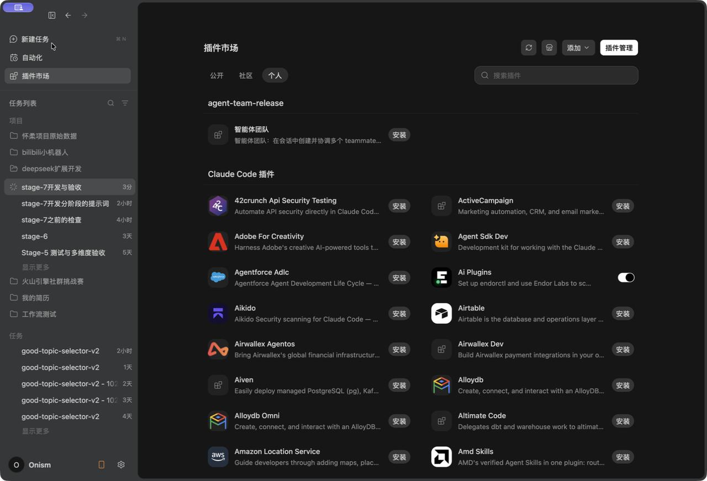

### 1.2 在设置中确认启用

**设置 → 插件** 的已安装列表中出现「智能体团队」，右侧开关为启用状态。hooks（SessionStart / Stop / UserPromptSubmit）随启用自动生效，无需额外开关或信任授予；可在 **设置 → 钩子** 查看这三条声明。

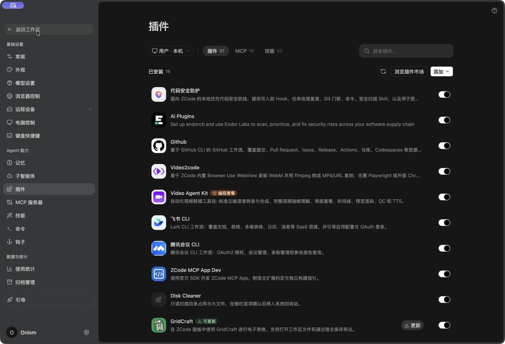

### 1.3 CLI 安装（可选）

```bash
zcode plugins marketplace add /path/to/market-root
zcode plugins install agent-team@<market-name>
zcode plugins enable agent-team@<market-name>
zcode plugins list | grep -A2 agent-team     # 确认版本与缓存路径
```

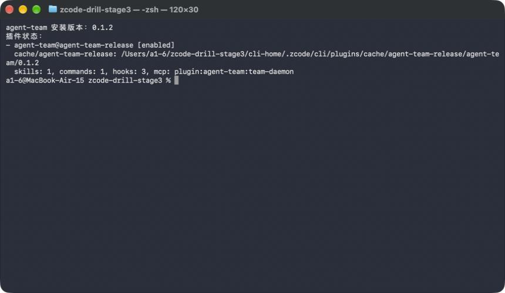

## 2. 快速上手

新建任务（旧任务不会刷新插件能力），发送：

```text
创建一个叫 reviewer 的队友，让它检查 README 前三段的错别字，然后汇总它的结论。
```

Lead 会创建 `reviewer`、分配任务，并在会话内渲染「智能体团队」面板；`reviewer` 完成后把结论发回，Lead 汇总给你。下图为首次运行时面板与 Lead 的进度：

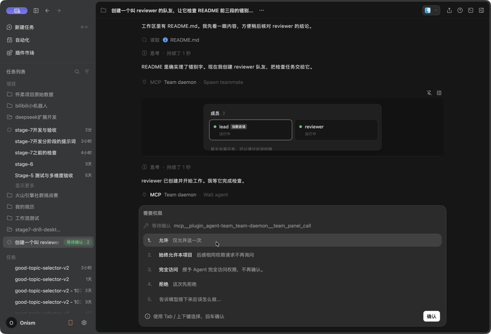

桌面默认权限模式下，首次调用团队工具会弹出权限确认；选择「允许（仅本次）」或「始终允许本项目」即可。这是宿主的工具授权，与 hook 无关。

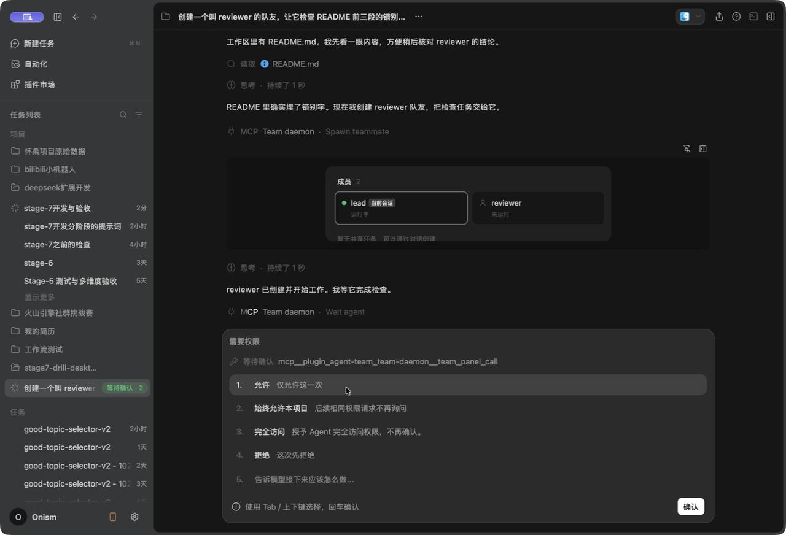

任务完成时，Lead 的最终答复与面板同屏可见：

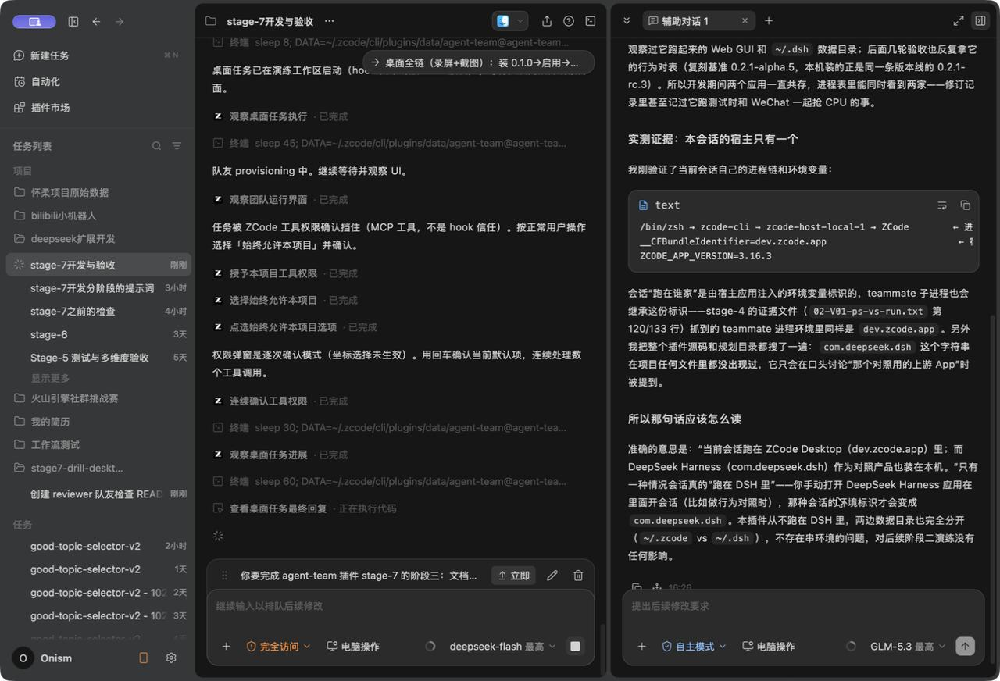

## 3. 面板说明

「智能体团队」面板是插件的主 UI（MCP Apps surface `agent-team-panel`），由宿主在会话内渲染，数据通过 `resources/subscribe` 实时推送。

| 区域 | 内容 |
|---|---|
| 成员 | Lead 与全部 teammate；名字、角色、状态点（运行中 / 未运行 / 创建中 / 失败）。Lead 行标「当前会话」 |
| 共享任务 | 任务标题、状态（待处理 / 进行中 / 已完成）、Owner、展开查看描述与验收记录 |
| 通知条 | 新消息、任务变化等提示（有变化时出现） |
| 刷新 | 订阅推送 ≤1s 自动刷新；面板心跳每 25s 一次，兼作 Lead 侧连接保活 |

成员卡片可打开成员会话查看视图（只读：按页载入成员转录，带 events/delivered 徽标）。静态卡片按保守口径映射活性（active→未运行），实时面板才显示运行中。

## 4. CLI：文本摘要（形态一）

CLI 会话没有图形面板，`/team` 命令输出文本摘要；其数据面与 `team-ctl state` 同源：

```bash
/team
# 或直接读盘重放
node <插件目录>/dist/team-ctl.mjs state <teamDir>
```

输出包含团队/会话、成员表、任务表、消息投递统计：

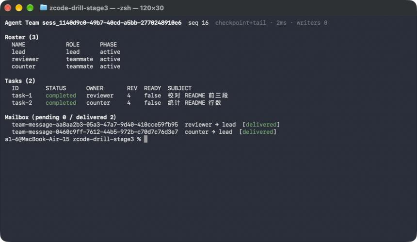

常用子命令：

```bash
node <插件目录>/dist/team-ctl.mjs state <teamDir> --json      # 机器可读
node <插件目录>/dist/team-ctl.mjs transcript <teamDir> <member>  # 成员会话流
node <插件目录>/dist/team-ctl.mjs tail <teamDir>              # 跟随事件日志
```

## 5. CLI：卡片（形态二）

`team-ctl widget` 生成与面板同源的静态卡片，可作为独立 HTML 打开或嵌入内容引用：

```bash
node <插件目录>/dist/team-ctl.mjs widget <teamDir> --standalone \
  --theme dark --lang zh --out /tmp/team-card.html
open /tmp/team-card.html
```

深色：

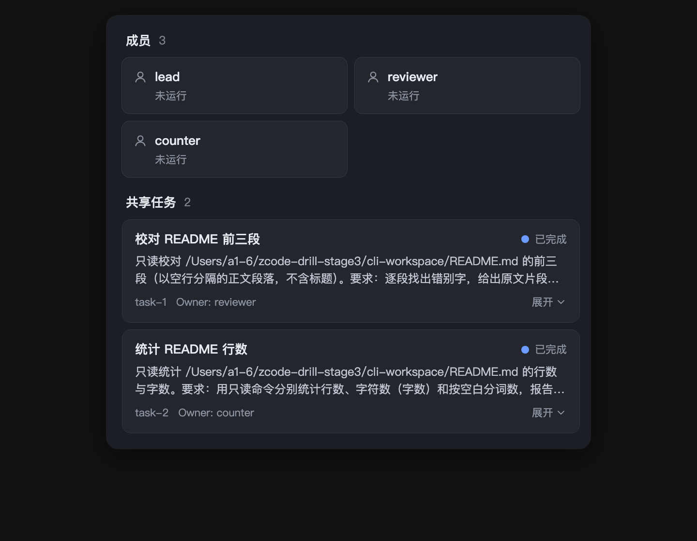

浅色：

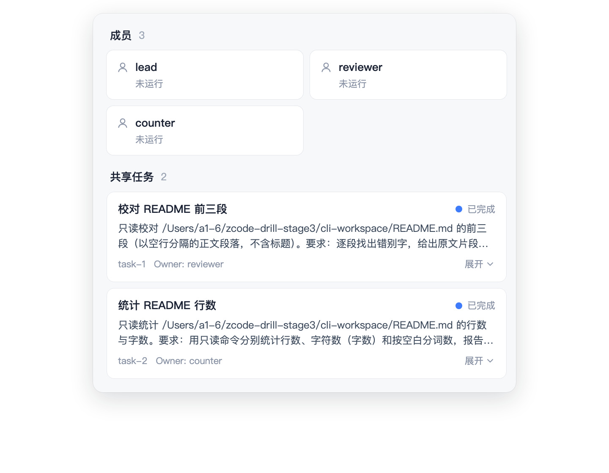

> 卡片为静态快照，不探测活性：成员状态显示为「未运行」属预期（限制 D21）。桌面里也可以让 Lead 生成 `::visualize` 内容引用卡片。

## 6. 升级

源码或市场目录更新后，**改源码不会热更新**，按以下步骤升级：

1. 插件市场 → 右上 **市场源** → 找到你的市场 → **刷新该市场**；
2. 回到 **个人**，插件卡片出现「可更新」→ 点 **更新**；
3. 升级后**新开任务**才使用新版本（宿主按会话固定插件运行时）。

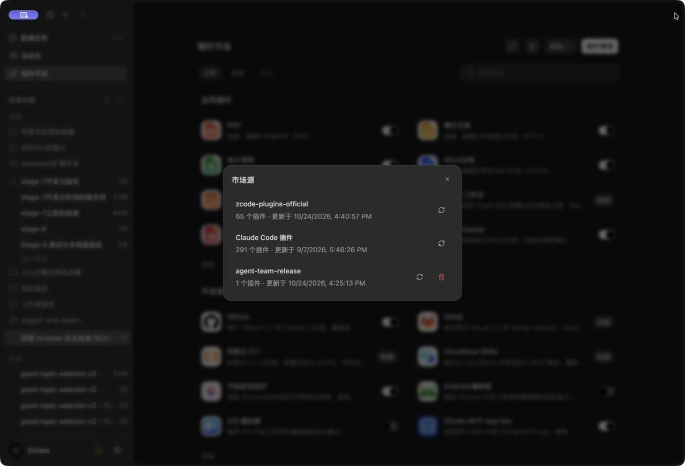

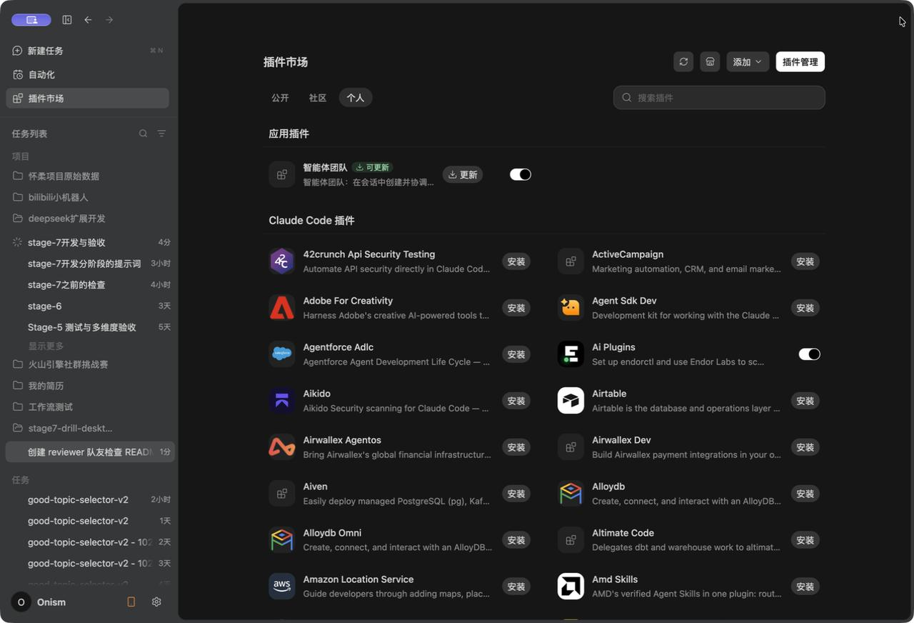

## 7. 卸载与数据

卸载前先备份插件数据目录（默认卸载会删除团队数据）：

```bash
DATA="$HOME/.zcode/cli/plugins/data/agent-team@<market>"
tar -czf ~/agent-team-backup-$(date +%Y%m%d).tar.gz -C "$(dirname "$DATA")" "$(basename "$DATA")"
```

桌面：**设置 → 插件 → 智能体团队 → 更多操作 → 卸载**。确认框会提示删除缓存、数据目录与配置：

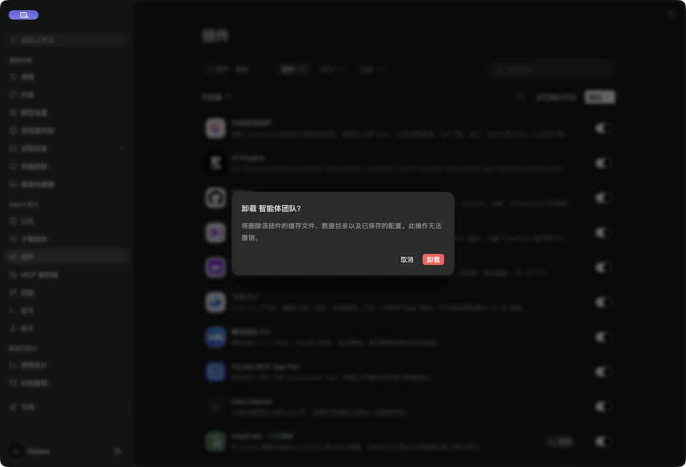

- CLI 默认卸载删除整个数据目录；需要保留数据用 `--keep-data`（非交互 shell 加 `--force`）。
- 桌面无「保留数据」选项；卸载后请关闭仍打开的相关任务窗口，否则旧会话可能重建一个**空**数据骨架（`events.jsonl` 0 字节，原数据不恢复）。
- 完整结论与备份指引见 [README「卸载后数据怎么处理」](../README.md#卸载后数据怎么处理)。

## 8. 截图与版本

| 截图 | 采集对象 | 采集时间 | 说明 |
|---|---|---|---|
| `cli-version.png`、`cli-text-summary.png`、`card-dark.png`、`card-light.png` | 0.1.2 安装实例（隔离 HOME） | 2026-10-24 | CLI 文本摘要与卡片由 0.1.2 的 `team-ctl` 实际生成；卡片用 Chromium 打开真实 standalone HTML 截图 |
| `panel-running.png`、`panel-final.png`、`tool-permission.png` | 发布演练实例（0.1.0 运行时） | 2026-10-24 | 面板/权限 UI |
| `settings-enabled.png`、`market-personal.png`、`market-sources.png`、`update-available.png`、`uninstall-confirm.png` | 发布演练实例（0.1.0→0.1.1） | 2026-10-24 | 市场与设置 UI |

版本一致性依据：0.1.2 与 0.1.1 的 `dist/` 逐字节相同（含 `dist/ui/team-panel.html`，sha256 `6c7a14a0e71dbea5cfb0014fa0e37ef0f794f047233d417f9df9d5fa4a743ad2`），0.1.2 仅改文档、清单版本与包内文档资源；上述 UI 截图中的布局与文案与当前版本一致，且截图中不显示会随版本变化的版本号字段。

> 采集限制：采集桌面截图时，演示机屏幕随后被锁定，无法再驱动桌面 UI 重拍；因此桌面截图为同一次发布演练的原始实拍（运行时 0.1.0/0.1.1），并以 `dist` 逐字节相同证明与 0.1.2 UI 一致。此事实同时登记在《最终验收汇总》V02 证据说明与 stage-7 勘误中。
